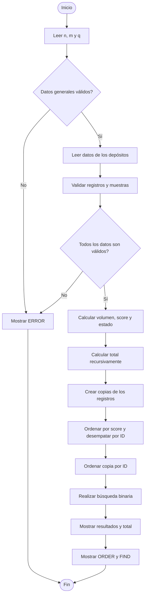

# PMC02 – Desbordamiento de un depósito

## 1. Descripción del proyecto

El proyecto consiste en desarrollar un simulador en lenguaje C que permita evaluar el comportamiento de varios depósitos a partir de una serie de muestras.

Cada depósito posee un identificador, un nombre, un tipo de configuración y un volumen inicial. A partir de las muestras recibidas, el programa calcula las variaciones del volumen, identifica los desbordamientos y determina el estado final de cada depósito.

Además, el programa calcula un acumulado general, ordena los depósitos según su puntuación y permite consultar el resultado de un depósito mediante su identificador.

## 2. Objetivo

Implementar una solución en C11 que procese y valide los datos de múltiples depósitos, aplique las reglas de simulación y presente los resultados correspondientes.

El desarrollo utiliza estructuras, arreglos, matrices, funciones, recursividad, ordenamiento y búsqueda binaria.

## 3. Datos de entrada

El programa recibe inicialmente tres valores:

| Variable | Descripción | Rango permitido |
|---|---|---|
| n | Cantidad de depósitos | 1 a 20 |
| m | Cantidad de muestras por depósito | 1 a 8 |
| q | Identificador que se desea buscar | 1 a 9999 |

Posteriormente, cada depósito contiene:

| Dato | Descripción | Restricción |
|---|---|---|
| id | Identificador | 1 a 9999, sin duplicados |
| nombre | Nombre del depósito | 1 a 15 caracteres |
| tipo | Configuración de operación | 0 o 1 |
| p | Volumen inicial | 0 a 100 |
| muestras | Valores recibidos | Cada valor entre 0 y 100 |

Los nombres aceptan letras ASCII mayúsculas y minúsculas, números y guion bajo.

## 4. Estructuras de datos

La implementación utiliza las siguientes estructuras:

- **Matriz de muestras:** almacena los valores de cada depósito mediante `int muestras[20][8]`.
- **Estructura Configuracion:** almacena el tipo de operación y el volumen inicial.
- **Estructura Registro:** almacena el identificador, nombre, configuración, puntuación y estado de cada depósito.
- **Arreglos auxiliares:** permiten realizar los ordenamientos sin alterar el orden original de los registros.

La definición de las estructuras y los prototipos de las funciones se encuentran en `reto.h`, mientras que la implementación del programa se encuentra en `main.c`.

## 5. Validación de datos

Antes de realizar los cálculos, el programa comprueba que todos los datos cumplan las condiciones establecidas.

Se verifican los siguientes aspectos:

1. La cantidad de depósitos y muestras debe encontrarse dentro de los límites permitidos.
2. Los identificadores deben estar entre 1 y 9999.
3. No pueden existir identificadores duplicados.
4. Los nombres deben tener entre 1 y 15 caracteres válidos.
5. El tipo de configuración debe ser 0 o 1.
6. El volumen inicial debe estar entre 0 y 100.
7. Todas las muestras deben estar entre 0 y 100.
8. La entrada debe estar completa y no contener datos adicionales.

Si se detecta algún dato inválido, el programa imprime `ERROR` y termina sin presentar resultados parciales.

## 6. Lógica de simulación

Cada depósito se procesa independientemente.

El volumen inicial se establece a partir del valor `p`, mientras que la puntuación comienza en cero.

Para cada muestra se calcula el balance:

**Balance = Muestra - 50**

Cuando el tipo de configuración es 0, el balance se aplica directamente. Cuando el tipo es 1, el balance se invierte.

A continuación, se calcula el nuevo volumen:

**Nuevo volumen = Volumen actual + Balance**

Se aplican las siguientes condiciones:

- Si el nuevo volumen supera 100, el volumen se establece en 100 y el exceso se acumula en la puntuación.
- Si el nuevo volumen es menor que 0, el volumen se establece en 0.
- Si el nuevo volumen se encuentra entre 0 y 100, se conserva su valor.

Una vez procesadas todas las muestras, se determina el estado final:

- Estado 1: volumen final mayor o igual a 50.
- Estado 0: volumen final menor que 50.

## 7. Procesamiento de resultados

### 7.1. Cálculo del total

Se utiliza la función recursiva `total_rec` para sumar las puntuaciones de todos los depósitos.

La función utiliza como caso base un número de registros igual a cero. En cada llamada suma la puntuación del último registro considerado y continúa con el anterior.

### 7.2. Ordenamiento por puntuación

Se utiliza el método de ordenamiento burbuja para organizar los depósitos según los siguientes criterios:

1. Puntuación en orden descendente.
2. En caso de empate, identificador en orden ascendente.

El ordenamiento se realiza sobre una copia de los registros para conservar intacto el orden de entrada.

### 7.3. Ordenamiento por identificador

Se crea una segunda copia de los registros y se ordena por identificador ascendente.

Esta copia se utiliza para facilitar la búsqueda binaria.

### 7.4. Búsqueda binaria

La función `buscar` realiza una búsqueda binaria sobre los registros previamente ordenados por identificador.

Si encuentra el identificador solicitado, devuelve su puntuación. Si no existe, devuelve `-1`.

## 8. Pseudocódigo general

```text
INICIO

    Leer n, m, q

    Validar los datos generales

    SI los datos generales son válidos ENTONCES

        PARA cada depósito HACER

            Leer identificador
            Leer nombre
            Leer tipo
            Leer volumen inicial
            Leer muestras

            Validar los datos del depósito
            Comprobar identificadores duplicados

        FIN PARA

    FIN SI

    SI los datos son válidos ENTONCES

        PARA cada depósito HACER

            volumen <- volumen inicial
            score <- 0

            PARA cada muestra HACER

                balance <- muestra - 50

                SI tipo = 1 ENTONCES
                    balance <- -balance
                FIN SI

                nuevo <- volumen + balance

                SI nuevo > 100 ENTONCES
                    score <- score + nuevo - 100
                    volumen <- 100
                SINO
                    SI nuevo < 0 ENTONCES
                        volumen <- 0
                    SINO
                        volumen <- nuevo
                    FIN SI
                FIN SI

            FIN PARA

            Determinar estado final

        FIN PARA

        Calcular total mediante recursividad

        Crear copias de los registros

        Ordenar por puntuación descendente
        Resolver empates por identificador ascendente

        Ordenar segunda copia por identificador ascendente

        Buscar q mediante búsqueda binaria

        Mostrar resultados en el orden original
        Mostrar total
        Mostrar ordenamiento
        Mostrar resultado de búsqueda

    SINO

        Mostrar ERROR

    FIN SI

FIN
```

## 9. Diagrama de flujo



## 10. Complejidad algorítmica

Considerando `n` como la cantidad de depósitos y `m` como la cantidad de muestras:

| Operación | Complejidad |
|---|---|
| Lectura y validación de muestras | O(n × m) |
| Detección de identificadores duplicados | O(n²) |
| Simulación de depósitos | O(n × m) |
| Suma recursiva | O(n) |
| Ordenamiento burbuja | O(n²) |
| Búsqueda binaria | O(log n) |

El espacio utilizado por la matriz de muestras es proporcional a `n × m`. Los arreglos auxiliares requieren espacio proporcional a `n`.

## 11. Organización del proyecto

```text
PMC02/
│
├── main.c
├── reto.h
├── README.md
├── plan.md
├── evaluar.py
├── publicas.json
├── propias.json
│
└── pruebas/
    ├── publicas/
    ├── propias/
```

## 12. Compilación

El programa se compila utilizando GCC con el estándar C11 y las opciones de advertencias:

```bash
gcc -std=c11 -Wall -Wextra -Wpedantic main.c -o reto
```

Para ejecutar el programa:

```bash
./reto
```

En Windows, desde una terminal con GCC:

```bash
.\reto.exe
```

## 13. Pruebas

La validación del proyecto contempla los seis casos públicos proporcionados y cuatro pruebas propias.

Las pruebas permiten comprobar el cálculo de los depósitos, la validación de entradas, el manejo de límites, el ordenamiento, el cálculo recursivo y la búsqueda binaria.

Los casos se documentan mediante los archivos JSON y se procesan con el evaluador `evaluar.py`.

## 14. Conclusión

El proyecto integra diferentes conceptos de programación estructurada y algorítmica para resolver un problema de simulación.

La solución combina validación de datos, estructuras, arreglos, matrices, funciones, recursividad, ordenamiento y búsqueda binaria. La separación del código en archivos permite mantener una organización clara y facilita su mantenimiento y evaluación.
